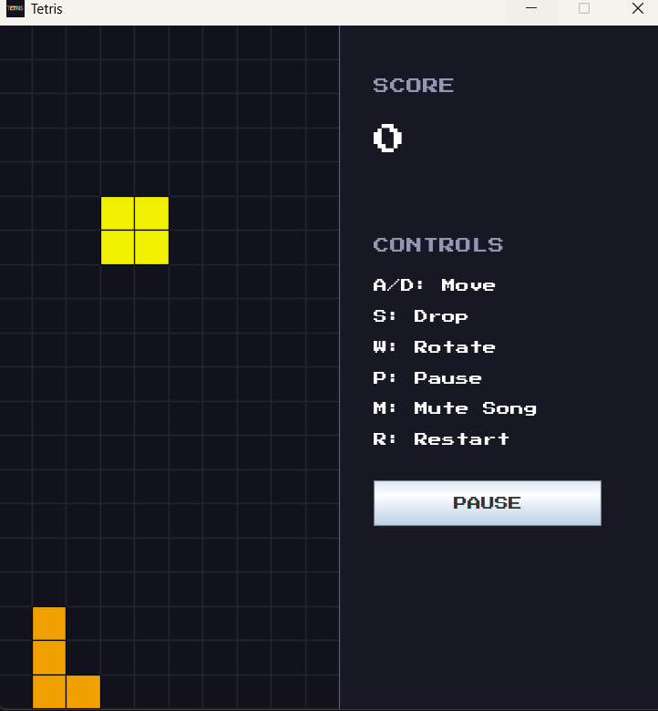

# Tetris

A classic Tetris game built in Java with Swing, featuring a retro pixel font, background music, scoring, a pause button and speed that increases as your score grows.

# Screenshot of the Game




## Download and play (Windows)

No Java needed.

1. Go to the [Releases page](https://github.com/Hamza-Galal/Tetris/releases) and download `Tetris-Windows.zip`.
2. Extract the zip.
3. Open the `Tetris` folder and double-click `Tetris.exe`.

> **Note:** Windows may show a "Windows protected your PC" warning because the app isn't code-signed. Click **More info**, then **Run anyway**.

## Controls

| Key | Action |
| --- | --- |
| A / Left Arrow | Move left |
| D / Right Arrow | Move right |
| S / Down Arrow | Soft drop |
| W / Up Arrow | Rotate |
| P | Pause / resume |
| M | Mute / unmute music |
| R | Restart |

## Scoring

| Lines cleared at once | Points |
| --- | --- |
| 1 | 100 |
| 2 | 300 |
| 3 | 500 |
| 4 | 800 |

## ⚡ Game speed

> **Notice:** The game gets faster as your score grows, so the longer you survive, the harder it becomes.

- Pieces start by falling one row every **350 ms**.
- Every **500 points**, they fall **20 ms faster**.
- The speed stops increasing at **100 ms** per row, which you reach at about **6,250 points**.
- Pressing **R** to restart resets the speed to the starting value.

## Features

- All 7 tetrominoes (I, O, T, S, Z, J, L) with rotation and wall kicks
- Line clearing and score tracking
- Speed that increases with your score
- Game over screen with quick restart
- Pause button and keyboard pause
- Looping background music with mute
- Retro Press Start 2P font

## Run from source

Requires JDK 17 or newer.

```
javac -d build -sourcepath src src\main\java\tetris\TetrisApplication.java
xcopy /e /i /y resources build\resources
java -cp build main.java.tetris.TetrisApplication
```

## Build the exe yourself

Requires JDK 17 or newer on Windows.

```
mkdir build dist release
javac -d build -sourcepath src src\main\java\tetris\TetrisApplication.java
xcopy /e /i /y resources build\resources
echo Main-Class: main.java.tetris.TetrisApplication> manifest.txt
jar cfm dist\Tetris.jar manifest.txt -C build .
jpackage --type app-image --name Tetris --input dist --main-jar Tetris.jar --main-class main.java.tetris.TetrisApplication --icon resources\icon.ico --dest release
```

The game is created at `release\Tetris\Tetris.exe`.

## Project structure

```
src/main/java/tetris/
├── TetrisApplication.java   # Entry point
├── Model/                   # Board, Tetromino, PieceGenerator
├── Engine/                  # GameLoop, MusicPlayer
├── Input/                   # KeyboardHandler
└── Ui/                      # GameFrame, GamePanel, PieceRenderer
resources/                   # Font, music, icons
```

## Credits

- Font: [Press Start 2P](https://fonts.google.com/specimen/Press+Start+2P) (SIL Open Font License)

## 📧 Contact

This project was developed by:

### 👨‍💻 Developer 1

**Name:** Hamza Ahmed

- LinkedIn: [LinkedIn Profile](https://www.linkedin.com/in/hamza-ahmed-3a531a372/)
- GitHub: [GitHub Profile](https://github.com/Hamza-Galal)